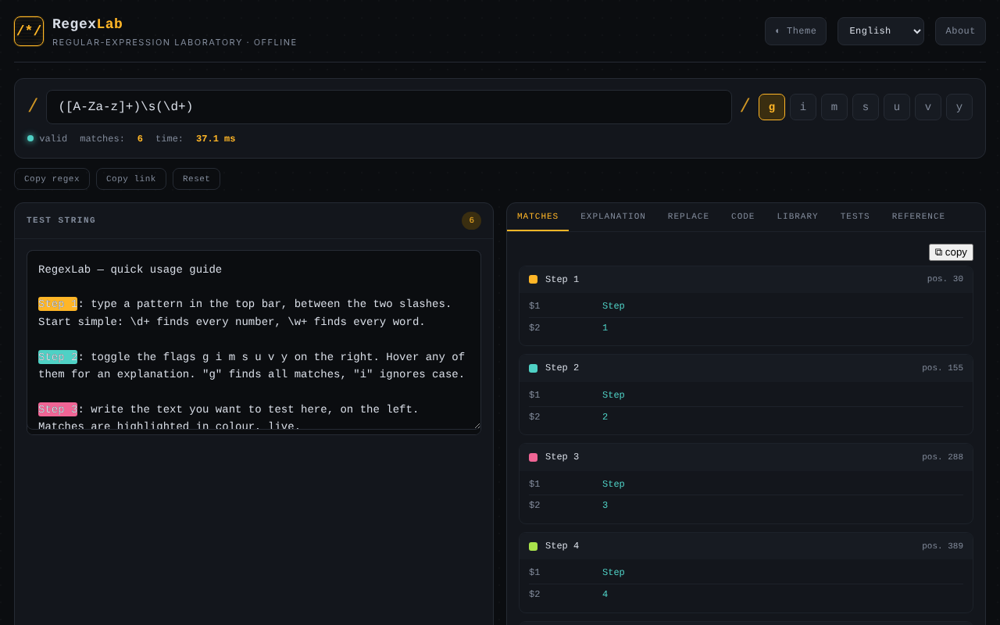

# RegexLab

[English](README.md) · [Română](README.ro.md) · [Français](README.fr.md) · [Italiano](README.it.md) · [Español](README.es.md) · [Português](README.pt.md) · **Deutsch** · [Magyar](README.hu.md)

**Version:** 1.1.0 · **Zuletzt aktualisiert:** 2026-10-14

Ein Labor für reguläre Ausdrücke: Echtzeit-Tests, Erklärungen, Ersetzung, Code-Schnipsel und eine Mustersammlung, in einer einzigen HTML-Datei.

**Online-Anwendung:** https://chiuta.github.io/RegexLab/

## Was es ist

RegexLab ist ein Werkzeug zum Schreiben und Testen von regulären JavaScript-Ausdrücken direkt im Browser. Der Testtext verlässt das Gerät nicht. Die Oberfläche gibt es in sieben Sprachen (Englisch, Rumänisch, Französisch, Italienisch, Spanisch, Portugiesisch, Deutsch); die Standardsprache ist Englisch.

## Funktionen

- Musterfeld (`/.../`), Flags `g i m s u v y` (`u` und `v` schließen sich gegenseitig aus), Gültigkeitsanzeige („valid“ / Fehler), Trefferzahl und Ausführungszeit.
- Bereich **Test string** mit Hervorhebung der Treffer.
- Reiter **Tests**: Testfälle, einer pro Zeile — `+ Text` muss passen, `- Text` darf nicht passen; zeigt bestanden/fehlgeschlagen pro Fall und die Gesamtzahl (im selben Web Worker ausgewertet, mit demselben Zeitlimit).
- Statische (heuristische) Warnung vor verschachtelten Quantifizierern, noch bevor ein Timeout erreicht wird.
- Die Code-Schnipsel passen benannte Gruppen für Python/Go an (`(?P<n>…)`) und fügen Hinweise hinzu, wenn die Syntax nicht verfügbar ist (Go: kein Lookaround/keine Rückreferenzen; Python: kein `\p{…}`; PHP: `\p{…}` erfordert den Modifikator `u`).
- Sieben Reiter: **Matches** (Treffer und Gruppen), **Explanation** (Erklärung des Musters), **Replace** (Ersetzung mit `$1`, `$2`, `$&`), **Code** (einfügefertige Schnipsel für JavaScript, Python, PHP und Go), **Library** (15 fertige Muster, in sieben Sprachen), **Tests** (Testfälle) und **Reference** (Referenzblatt).
- Die Auswertung läuft in einem Web Worker mit einem Zeitlimit von 1500 ms und einer Warnmeldung bei möglichem „catastrophic backtracking“.
- Schaltflächen **Copy regex**, **Copy link** (Permalink mit Muster, Flags, Text und Ersetzung im `#`-Fragment der URL) und **Reset**.
- Helles / dunkles Design (**Theme**), Fenster **About**.

## Anleitung

1. Öffnen Sie die Seite und wählen Sie die Sprache in der Sprachauswahl der Kopfzeile.
2. Geben Sie das Muster in das obere Feld ein und setzen Sie die gewünschten Flags.
3. Fügen Sie den Text in **Test string** ein oder schreiben Sie ihn; die Ergebnisse erscheinen sofort im Reiter **Matches**.
4. Öffnen Sie **Explanation** für eine Aufschlüsselung des Musters.
5. Geben Sie in **Replace** die Ersetzungsvorlage (`$1`, `$2`, `$&`) ein und lesen Sie das Ergebnis.
6. Kopieren Sie in **Code** den Schnipsel für die gewünschte Sprache mit der Schaltfläche ⧉.
7. Klicken Sie in **Library** auf ein Muster, um es zu laden; in **Reference** finden Sie die Grundsyntax.
8. **Copy link** erzeugt einen Link mit dem aktuellen Zustand; **Reset** kehrt zum Standardbeispiel zurück; **Esc** schließt das About-Fenster.

## Datenschutz und Netzwerk

- **Lokaler Speicher (localStorage):** sieben `regexlab-*`-Schlüssel: `regexlab-pattern`, `regexlab-flags`, `regexlab-subject`, `regexlab-replace`, `regexlab-tests`, `regexlab-lang`, `regexlab-theme`. Sie bleiben nur in Ihrem Browser.
- **Netzwerk:** Im Code gibt es keine Netzwerkanfragen, externen Skripte oder Schriftarten. Das About-Fenster enthält Links (Buy Me a Coffee, Website, Kontakt), die sich nur per Klick öffnen. Keine Analyse- oder Telemetriedaten.
- Der mit **Copy link** erzeugte Link enthält das Muster und den Testtext in der URL; geben Sie ihn nicht weiter, wenn der Text sensibel ist.

## Lokale Ausführung / offline

Laden Sie `index.html` herunter und öffnen Sie sie in einem Browser; sie funktioniert ohne Internet.

## Verlauf / Changelog

### 1.1.0 — 2026-10-14
- Sicherungskopie und Datenkennzeichnung (fff-kit).

### 12. Oktober 2026 — Version 1.0.0
- 1.0.0 — 2026-10-12: Die Version und das Datum der letzten Aktualisierung werden in der Anwendung angezeigt

### 11. Oktober 2026 (dritter Durchgang)
- Das Flag `v` (unicodeSets: Mengenoperationen, z. B. `[\p{L}--[a-z]]`); `u` und `v` schließen sich gegenseitig aus, und die Python/PHP-Schnipsel behandeln es als `u`. CSP: Hash neu berechnet.

### 11. Oktober 2026 (zweiter Durchgang)
- Reiter **Tests** mit `+`/`-`-Fällen; heuristische Warnung vor verschachtelten Quantifizierern; Python/Go/PHP-Schnipsel für benannte Gruppen korrigiert und mit Kompatibilitätshinweisen versehen; neue Texte in allen 7 Sprachen. CSP: Hash neu berechnet.

### 11. Oktober 2026
- Barrierefreiheit: Der Hauptinhalt ist in `<main>` eingefasst (Kopf- und Fußzeile bleiben getrennte Landmarken); axe-core meldet 0 Verstöße bei 1280 und 360 px.
- CSP: `script-src` verwendet einen SHA-256-Hash statt `'unsafe-inline'` (der `blob:`-Worker bleibt erlaubt); mit aktiver CSP geprüft: Treffersuche und Worker funktionieren.

## Lizenz

MIT — siehe Datei LICENSE.

## Audit

Audit: 2026-10-10 — die Aussagen der README (keine Netzwerkanfragen, Speicherung nur in localStorage) stimmen mit dem Code überein; kein `fetch`/CDN/WebSocket. Korrekturen bei Kontrast und ARIA.

## Autor

Alexio — Alexandru-Ionuț Chiuță. Kontakt: alexio@trom.tf

## Zusammenfassung

RegexLab ist ein Labor für reguläre Ausdrücke in einer einzigen Datei: Live-Abgleich mit Hervorhebung, Erklärung, Ersetzung, Code-Schnipsel (JavaScript, Python, PHP, Go), eine Bibliothek mit 15 Mustern und ein Referenzblatt, mit Oberfläche in 7 Sprachen. Der Abgleich läuft in einem Web Worker mit einem Timeout von 1,5 s. Der Zustand wird in localStorage gehalten; keine Netzwerkanfragen und keine Telemetrie. MIT-Lizenz.
