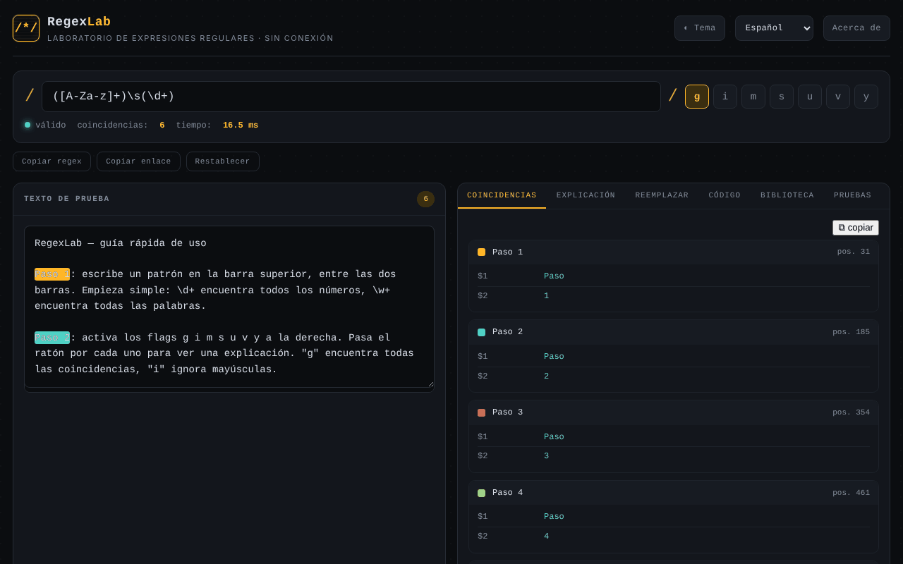

# RegexLab

[English](README.md) · [Română](README.ro.md) · [Français](README.fr.md) · [Italiano](README.it.md) · **Español** · [Português](README.pt.md) · [Deutsch](README.de.md) · [Magyar](README.hu.md)

**Versión:** 1.2.10 · **Última actualización:** 2026-10-26

Idiomas de la interfaz: **Română, English, Français, Italiano, Español, Português (PT), Deutsch, Magyar**

Laboratorio de expresiones regulares: pruebas en tiempo real, explicaciones, sustitución, fragmentos de código y biblioteca de patrones, en un único archivo HTML.

**Aplicación en línea:** https://chiuta.github.io/RegexLab/

## Qué es

RegexLab es una herramienta para escribir y probar expresiones regulares de JavaScript directamente en el navegador. El texto de prueba no sale del dispositivo. La interfaz tiene ocho idiomas (inglés, rumano, francés, italiano, español, portugués, alemán, húngaro); el idioma predeterminado es el inglés.

## Funciones

- Campo del patrón (`/.../`), indicadores `g i m s u v y` (`u` y `v` se excluyen mutuamente), indicador de validez ("valid" / error), número de coincidencias y tiempo de ejecución.
- Zona **Test string** con resaltado de las coincidencias.
- Pestaña **Tests**: casos de prueba, uno por línea — `+ texto` debe coincidir, `- texto` no; muestra acierto/fallo por caso y el total (evaluados en el mismo Web Worker, con el mismo límite de tiempo).
- Aviso estático (heurístico) para cuantificadores anidados, antes de llegar al tiempo de espera.
- Los fragmentos de código adaptan los grupos con nombre para Python/Go (`(?P<n>…)`) y añaden notas cuando la sintaxis no está disponible (Go: sin lookaround/referencias inversas; Python: sin `\p{…}`; PHP: `\p{…}` requiere el modificador `u`).
- Siete pestañas: **Matches** (coincidencias y grupos), **Explanation** (explicación del patrón), **Replace** (sustitución con `$1`, `$2`, `$&`), **Code** (fragmentos listos para pegar para JavaScript, Python, PHP y Go), **Library** (15 patrones ya hechos, en ocho idiomas), **Tests** (casos de prueba) y **Reference** (hoja de referencia).
- La evaluación se ejecuta en un Web Worker, con un límite de tiempo de 1500 ms y un mensaje de advertencia ante un posible "catastrophic backtracking".
- Botones **Copy regex**, **Copy link** (enlace permanente con el patrón, los indicadores, el texto y la sustitución en el fragmento `#` de la URL) y **Reset**.
- Tema claro / oscuro (**Theme**), ventana **About**.

## Manual de uso

1. Abre la página y elige el idioma en la lista desplegable de idiomas del encabezado.
2. Escribe el patrón en el campo superior y marca los indicadores deseados.
3. Pega o escribe el texto en **Test string**; los resultados aparecen de inmediato en la pestaña **Matches**.
4. Abre **Explanation** para ver un desglose del patrón.
5. En **Replace**, escribe la plantilla de sustitución (`$1`, `$2`, `$&`) y lee el resultado.
6. En **Code**, copia el fragmento del lenguaje deseado con el botón ⧉.
7. En **Library**, pulsa un patrón para cargarlo; en **Reference** encontrarás la sintaxis básica.
8. **Copy link** crea un enlace con el estado actual; **Reset** vuelve al ejemplo predeterminado; **Esc** cierra la ventana About.

## Privacidad y red

- **Almacenamiento local (localStorage):** siete claves `regexlab-*`: `regexlab-pattern`, `regexlab-flags`, `regexlab-subject`, `regexlab-replace`, `regexlab-tests`, `regexlab-lang`, `regexlab-theme`. Permanecen solo en tu navegador.
- **Red:** en el código no hay solicitudes de red, scripts ni fuentes externas. La ventana About contiene enlaces (Buy Me a Coffee, sitio web, contacto) que se abren solo al hacer clic. Sin analítica ni telemetría.
- El enlace creado con **Copy link** incluye en la URL el patrón y el texto de prueba; no lo compartas si el texto es sensible.

## Ejecución local / sin conexión

Descarga `index.html` y ábrelo en un navegador; funciona sin internet.

## Historial / Registro de cambios

### 1.2.9 — 2026-10-23

- Objetivos táctiles de al menos 44 px en dispositivos táctiles (`pointer:coarse`); el escritorio no cambia.

### 1.2.8 — 2026-10-23

- CSP reforzada: se quitó `blob:` de `script-src` (el Worker `blob:` sigue permitido mediante `worker-src`).

### 1.2.6 — 2026-10-22

fff-kit 1.1.4: objetivos táctiles y tamaño mínimo de texto.

### 1.2.5 — 2026-10-22
- Límites de longitud para el patrón (10 000 caracteres), el texto de prueba (200 000), el reemplazo y los casos de prueba, con un mensaje traducido: pegar 1 MB ya no bloquea la página (la búsqueda ya se ejecutaba en un Web Worker con tiempo límite).

### 1.2.4 — 2026-10-22
- fff-kit 1.1.2: PBKDF2 con 600.000 iteraciones, protección anti-clickjacking

### 1.2.3 — 2026-10-22
- Móvil: el texto pequeño pasa a un mínimo de 12 px; el botón «copiar coincidencias» y el enlace del pie tienen áreas táctiles mayores (el tiempo límite ReDoS en un Web Worker ya existía).

### 1.2.2 — 2026-10-22
- Las etiquetas de campos y botones para lectores de pantalla (expresión regular, texto de prueba, reemplazo, pruebas, cerrar, idioma, tema) ya están traducidas y se actualizan al cambiar de idioma.

### 1.2.1 — 2026-10-22
- Correcciones de traducción: el título de la página y las metaetiquetas siguen el idioma de la interfaz; eliminados los textos que quedaban en el idioma equivocado.

### 1.1.0 — 2026-10-14
- Copia de seguridad y etiquetado de datos (fff-kit).

### 12 de octubre de 2026 — versión 1.0.0
- 1.0.0 — 2026-10-12: la versión y la fecha de la última actualización se muestran en la aplicación

### 11 de octubre de 2026 (tercera pasada)
- El indicador `v` (unicodeSets: operaciones con conjuntos, p. ej. `[\p{L}--[a-z]]`); `u` y `v` se excluyen mutuamente, y los fragmentos de Python/PHP lo tratan como `u`. CSP: hash recalculado.

### 11 de octubre de 2026 (segunda pasada)
- Pestaña **Tests** con casos `+`/`-`; aviso heurístico para cuantificadores anidados; fragmentos de Python/Go/PHP corregidos para grupos con nombre y con notas de compatibilidad; textos nuevos en los 7 idiomas. CSP: hash recalculado.

### 11 de octubre de 2026
- Accesibilidad: el contenido principal está envuelto en `<main>` (el encabezado y el pie siguen siendo regiones separadas); axe-core informa de 0 infracciones a 1280 y 360 px.
- CSP: `script-src` usa un hash SHA-256 en lugar de `'unsafe-inline'` (el worker `blob:` sigue permitido); verificado con la CSP activa: las coincidencias y el worker funcionan.

## Licencia

MIT — consulta el archivo LICENSE.

## Auditoría

Auditoría: 2026-10-10 — las afirmaciones del README (sin solicitudes de red, almacenamiento solo en localStorage) coinciden con el código; sin `fetch`/CDN/WebSocket. Correcciones de contraste y ARIA.

## Autor

Alexio — Alexandru-Ionuț Chiuță. Contacto: alexio@trom.tf

## Resumen

RegexLab es un laboratorio de expresiones regulares en un único archivo: coincidencia en vivo con resaltado, explicación, sustitución, fragmentos de código (JavaScript, Python, PHP, Go), una biblioteca de 15 patrones y una hoja de referencia, con interfaz en 8 idiomas. La coincidencia se ejecuta en un Web Worker con un tiempo de espera de 1,5 s. El estado se guarda en localStorage; sin solicitudes de red ni telemetría. Licencia MIT.
