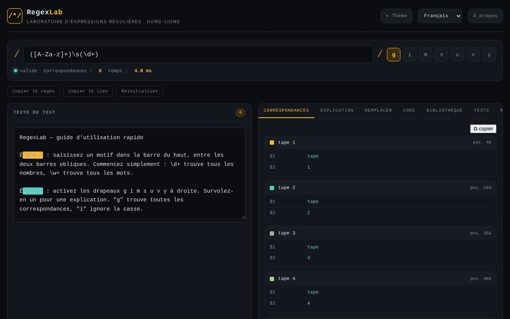

# RegexLab

[English](README.md) · [Română](README.ro.md) · **Français** · [Italiano](README.it.md) · [Español](README.es.md) · [Português](README.pt.md) · [Deutsch](README.de.md) · [Magyar](README.hu.md)

**Version :** 1.2.2 · **Dernière mise à jour :** 2026-10-22

Langues de l'interface : **Română, English, Français, Italiano, Español, Português (PT), Deutsch, Magyar**

Laboratoire d'expressions régulières : test en temps réel, explications, remplacement, extraits de code et bibliothèque de modèles, dans un seul fichier HTML.

**Application en ligne :** https://chiuta.github.io/RegexLab/

## Ce que c'est

RegexLab est un outil pour écrire et tester des expressions régulières JavaScript directement dans le navigateur. Le texte de test ne quitte pas l'appareil. L'interface existe en huit langues (anglais, roumain, français, italien, espagnol, portugais, allemand, hongrois) ; la langue par défaut est l'anglais.

## Fonctions

- Champ du modèle (`/.../`), drapeaux `g i m s u v y` (`u` et `v` s'excluent mutuellement), indicateur de validité (« valid » / erreur), nombre de correspondances et temps d'exécution.
- Zone **Test string** avec mise en évidence des correspondances.
- Onglet **Tests** : cas de test, un par ligne — `+ texte` doit correspondre, `- texte` ne doit pas correspondre ; affiche réussite/échec par cas et le total (évalués dans le même Web Worker, avec la même limite de temps).
- Avertissement statique (heuristique) pour les quantificateurs imbriqués, avant d'atteindre le délai d'expiration.
- Les extraits de code adaptent les groupes nommés pour Python/Go (`(?P<n>…)`) et ajoutent des notes lorsque la syntaxe n'est pas disponible (Go : pas de lookaround/références arrière ; Python : pas de `\p{…}` ; PHP : `\p{…}` exige le modificateur `u`).
- Sept onglets : **Matches** (correspondances et groupes), **Explanation** (explication du modèle), **Replace** (remplacement avec `$1`, `$2`, `$&`), **Code** (extraits prêts à coller pour JavaScript, Python, PHP et Go), **Library** (15 modèles prêts à l'emploi, en huit langues), **Tests** (cas de test) et **Reference** (aide-mémoire).
- L'évaluation s'exécute dans un Web Worker, avec une limite de temps de 1500 ms et un message d'avertissement en cas de possible « catastrophic backtracking ».
- Boutons **Copy regex**, **Copy link** (permalien avec le modèle, les drapeaux, le texte et le remplacement dans le fragment `#` de l'URL) et **Reset**.
- Thème clair / sombre (**Theme**), fenêtre **About**.

## Mode d'emploi

1. Ouvrez la page et choisissez la langue dans la liste déroulante des langues de l'en-tête.
2. Saisissez le modèle dans le champ du haut et cochez les drapeaux souhaités.
3. Collez ou saisissez le texte dans **Test string** ; les résultats apparaissent immédiatement dans l'onglet **Matches**.
4. Ouvrez **Explanation** pour une décomposition du modèle.
5. Dans **Replace**, saisissez le modèle de remplacement (`$1`, `$2`, `$&`) et lisez le résultat.
6. Dans **Code**, copiez l'extrait pour le langage souhaité avec le bouton ⧉.
7. Dans **Library**, cliquez sur un modèle pour le charger ; dans **Reference**, vous trouverez la syntaxe de base.
8. **Copy link** crée un lien avec l'état actuel ; **Reset** revient à l'exemple par défaut ; **Échap** ferme la fenêtre About.

## Confidentialité et réseau

- **Stockage local (localStorage) :** sept clés `regexlab-*` : `regexlab-pattern`, `regexlab-flags`, `regexlab-subject`, `regexlab-replace`, `regexlab-tests`, `regexlab-lang`, `regexlab-theme`. Elles restent uniquement dans votre navigateur.
- **Réseau :** le code ne contient aucune requête réseau, aucun script ni police externe. La fenêtre About contient des liens (Buy Me a Coffee, site, contact) qui ne s'ouvrent qu'au clic. Aucun outil d'analyse ni télémétrie.
- Le lien créé avec **Copy link** inclut le modèle et le texte de test dans l'URL ; ne le partagez pas si le texte est sensible.

## Exécution locale / hors ligne

Téléchargez `index.html` et ouvrez-le dans un navigateur ; il fonctionne sans internet.

## Historique / Journal des modifications

### 1.2.2 — 2026-10-22
- Les libellés des champs et boutons pour lecteurs d’écran (expression régulière, texte de test, remplacement, tests, fermer, langue, thème) sont désormais traduits et suivent la langue choisie.

### 1.2.1 — 2026-10-22
- Corrections de traduction : le titre de la page et les balises meta suivent la langue de l’interface ; textes restés dans la mauvaise langue supprimés.

### 1.1.0 — 2026-10-14
- Copie de sauvegarde et étiquetage des données (fff-kit).

### 12 octobre 2026 — version 1.0.0
- 1.0.0 — 2026-10-12 : la version et la date de la dernière mise à jour sont affichées dans l'application

### 11 octobre 2026 (troisième passage)
- Le drapeau `v` (unicodeSets : opérations sur les ensembles, p. ex. `[\p{L}--[a-z]]`) ; `u` et `v` s'excluent mutuellement, et les extraits Python/PHP le traitent comme `u`. CSP : empreinte recalculée.

### 11 octobre 2026 (deuxième passage)
- Onglet **Tests** avec cas `+`/`-` ; avertissement heuristique pour les quantificateurs imbriqués ; extraits Python/Go/PHP corrigés pour les groupes nommés et accompagnés de notes de compatibilité ; nouveaux textes dans les 7 langues. CSP : empreinte recalculée.

### 11 octobre 2026
- Accessibilité : le contenu principal est encadré par `<main>` (l'en-tête et le pied de page restent des repères distincts) ; axe-core signale 0 violation à 1280 et 360 px.
- CSP : `script-src` utilise une empreinte SHA-256 au lieu de `'unsafe-inline'` (le worker `blob:` reste autorisé) ; vérifié avec la CSP active : les correspondances et le worker fonctionnent.

## Licence

MIT — voir le fichier LICENSE.

## Audit

Audit : 2026-10-10 — les affirmations du README (aucune requête réseau, stockage uniquement dans localStorage) correspondent au code ; aucun `fetch`/CDN/WebSocket. Corrections de contraste et d'ARIA.

## Auteur

Alexio — Alexandru-Ionuț Chiuță. Contact : alexio@trom.tf

## Résumé

RegexLab est un laboratoire d'expressions régulières en un seul fichier : correspondance en direct avec surlignage, explication, remplacement, extraits de code (JavaScript, Python, PHP, Go), une bibliothèque de 15 modèles et un aide-mémoire, avec une interface en 8 langues. La correspondance s'exécute dans un Web Worker avec un délai de 1,5 s. L'état est conservé dans localStorage ; aucune requête réseau ni télémétrie. Licence MIT.
