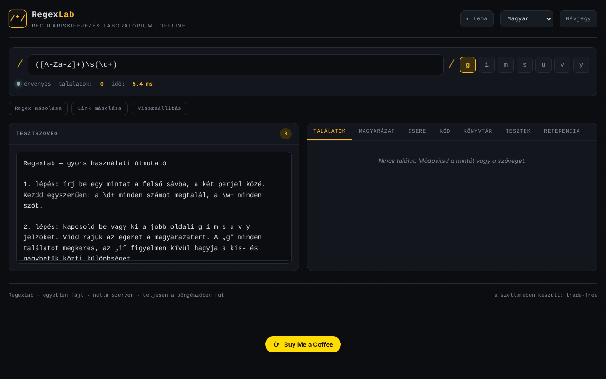

# RegexLab

[English](README.md) · [Română](README.ro.md) · [Français](README.fr.md) · [Italiano](README.it.md) · [Español](README.es.md) · [Português](README.pt.md) · [Deutsch](README.de.md) · **Magyar**

**Verzió:** 1.2.3 · **Utolsó frissítés:** 2026-10-22

A felület nyelvei: **Română, English, Français, Italiano, Español, Português (PT), Deutsch, Magyar**

Reguláris kifejezések laboratóriuma: valós idejű tesztelés, magyarázatok, csere, kódrészletek és mintakönyvtár, egyetlen HTML-fájlban.

**Online alkalmazás:** https://chiuta.github.io/RegexLab/

## Mi ez

A RegexLab egy eszköz JavaScript reguláris kifejezések írására és tesztelésére közvetlenül a böngészőben. A tesztszöveg nem hagyja el az eszközt. A felület nyolc nyelvű (angol, román, francia, olasz, spanyol, portugál, német, magyar); az alapértelmezett nyelv az angol.

## Funkciók

- Mintamező (`/.../`), `g i m s u v y` jelzők (a `u` és a `v` kölcsönösen kizárja egymást), érvényességjelző („valid” / hiba), találatok száma és futási idő.
- **Test string** terület a találatok kiemelésével.
- **Tests** lap: tesztesetek, soronként egy — a `+ szöveg` esetnek illeszkednie kell, a `- szöveg` esetnek nem; esetenként megjeleníti a sikert/hibát és az összesítést (ugyanabban a Web Workerben, ugyanazzal az időkorláttal értékeli ki).
- Statikus (heurisztikus) figyelmeztetés az egymásba ágyazott kvantorokra, még az időtúllépés elérése előtt.
- A kódrészletek a Pythonhoz/Gohoz igazítják a névvel ellátott csoportokat (`(?P<n>…)`), és megjegyzést fűznek hozzá, ha a szintaxis nem érhető el (Go: nincs lookaround/visszahivatkozás; Python: nincs `\p{…}`; PHP: a `\p{…}` a `u` módosítót igényli).
- Hét lap: **Matches** (találatok és csoportok), **Explanation** (a minta magyarázata), **Replace** (csere `$1`, `$2`, `$&` használatával), **Code** (beillesztésre kész részletek JavaScripthez, Pythonhoz, PHP-hoz és Gohoz), **Library** (15 kész minta, nyolc nyelven), **Tests** (tesztesetek) és **Reference** (referencialap).
- A kiértékelés Web Workerben fut, 1500 ms-os időkorláttal és figyelmeztető üzenettel az esetleges „catastrophic backtracking” esetére.
- **Copy regex**, **Copy link** (állandó hivatkozás a mintával, a jelzőkkel, a szöveggel és a cserével az URL `#` töredékében) és **Reset** gombok.
- Világos / sötét téma (**Theme**), **About** ablak.

## Használati útmutató

1. Nyissa meg az oldalt, és válasszon nyelvet a fejléc nyelvválasztó legördülő listájából.
2. Írja be a mintát a felső mezőbe, és jelölje be a kívánt jelzőket.
3. Illessze be vagy írja be a szöveget a **Test string** mezőbe; az eredmények azonnal megjelennek a **Matches** lapon.
4. Nyissa meg az **Explanation** lapot a minta részletes bontásához.
5. A **Replace** lapon írja be a cseresablont (`$1`, `$2`, `$&`), és olvassa le az eredményt.
6. A **Code** lapon másolja ki a kívánt nyelvhez tartozó részletet a ⧉ gombbal.
7. A **Library** lapon egy mintára kattintva betöltheti azt; a **Reference** lapon megtalálja az alapvető szintaxist.
8. A **Copy link** hivatkozást hoz létre az aktuális állapottal; a **Reset** visszaállítja az alapértelmezett példát; az **Esc** bezárja az About ablakot.

## Adatvédelem és hálózat

- **Helyi tárolás (localStorage):** hét `regexlab-*` kulcs: `regexlab-pattern`, `regexlab-flags`, `regexlab-subject`, `regexlab-replace`, `regexlab-tests`, `regexlab-lang`, `regexlab-theme`. Kizárólag a böngészőjében maradnak.
- **Hálózat:** a kódban nincsenek hálózati kérések, külső szkriptek vagy betűtípusok. Az About ablak hivatkozásokat tartalmaz (Buy Me a Coffee, weboldal, kapcsolat), amelyek csak kattintásra nyílnak meg. Nincs analitika vagy telemetria.
- A **Copy link** segítségével létrehozott hivatkozás az URL-ben tartalmazza a mintát és a tesztszöveget; ne ossza meg, ha a szöveg érzékeny.

## Helyi futtatás / offline

Töltse le az `index.html` fájlt, és nyissa meg böngészőben; internet nélkül is működik.

## Előzmények / Változásnapló

### 1.2.3 — 2026-10-22
- Mobil: a kis szöveg legalább 12 px; a „találatok másolása” gomb és a lábléc hivatkozása nagyobb érintési felületű (a Web Workerben futó ReDoS-időkorlát már megvolt).

### 1.2.2 — 2026-10-22
- A mezők és gombok képernyőolvasós címkéi (reguláris kifejezés, tesztszöveg, csere, tesztek, bezárás, nyelv, téma) mostantól le vannak fordítva, és nyelvváltáskor frissülnek.

### 1.2.1 — 2026-10-22
- Fordítási javítások: az oldalcím és a meta címkék követik a felület nyelvét; a rossz nyelven maradt szövegek eltávolítva.

### 1.1.0 — 2026-10-14
- Biztonsági másolat és adatcímkézés (fff-kit).

### 2026. október 12. — 1.0.0 verzió
- 1.0.0 — 2026-10-12: a verzió és az utolsó frissítés dátuma megjelenik az alkalmazásban

### 2026. október 11. (harmadik menet)
- A `v` jelző (unicodeSets: halmazműveletek, pl. `[\p{L}--[a-z]]`); a `u` és a `v` kölcsönösen kizárja egymást, a Python/PHP részletek pedig `u`-ként kezelik. CSP: az ellenőrzőösszeg újraszámolva.

### 2026. október 11. (második menet)
- **Tests** lap `+`/`-` esetekkel; heurisztikus figyelmeztetés az egymásba ágyazott kvantorokra; a Python/Go/PHP részletek javítva a névvel ellátott csoportokhoz, kompatibilitási megjegyzésekkel; új szövegek mind a 7 nyelven. CSP: az ellenőrzőösszeg újraszámolva.

### 2026. október 11.
- Akadálymentesség: a fő tartalom `<main>` elembe van foglalva (a fejléc és a lábléc külön tájékozódási pont marad); az axe-core 0 szabálysértést jelez 1280 és 360 px szélességnél.
- CSP: a `script-src` az `'unsafe-inline'` helyett SHA-256 ellenőrzőösszeget használ (a `blob:` worker továbbra is engedélyezett); aktív CSP mellett ellenőrizve: az illesztés és a worker működik.

## Licenc

MIT — lásd a LICENSE fájlt.

## Audit

Audit: 2026-10-10 — a README állításai (nincsenek hálózati kérések, tárolás csak a localStorage-ban) megfelelnek a kódnak; nincs `fetch`/CDN/WebSocket. Kontraszt- és ARIA-javítások.

## Szerző

Alexio — Alexandru-Ionuț Chiuță. Kapcsolat: alexio@trom.tf

## Összefoglaló

A RegexLab egy egyfájlos reguláris kifejezés-laboratórium: élő illesztés kiemeléssel, magyarázat, csere, kódrészletek (JavaScript, Python, PHP, Go), egy 15 mintát tartalmazó könyvtár és egy referencialap, 8 nyelvű felülettel. Az illesztés Web Workerben fut, 1,5 s-os időkorláttal. Az állapotot a localStorage őrzi; nincsenek hálózati kérések vagy telemetria. MIT licenc.
