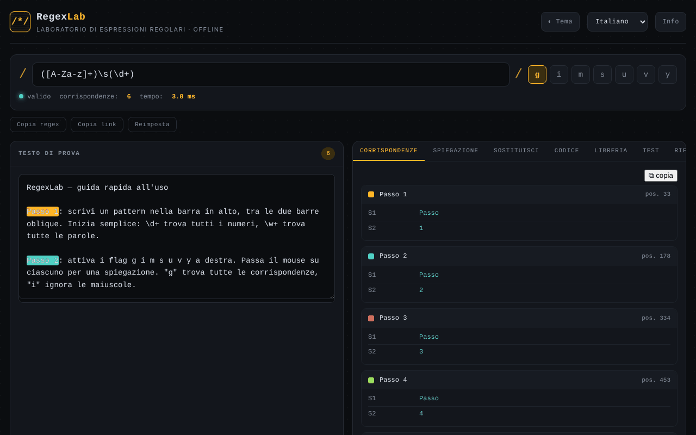

# RegexLab

[English](README.md) · [Română](README.ro.md) · [Français](README.fr.md) · **Italiano** · [Español](README.es.md) · [Português](README.pt.md) · [Deutsch](README.de.md) · [Magyar](README.hu.md)

**Versione:** 1.2.4 · **Ultimo aggiornamento:** 2026-10-22

Lingue dell'interfaccia: **Română, English, Français, Italiano, Español, Português (PT), Deutsch, Magyar**

Laboratorio di espressioni regolari: test in tempo reale, spiegazioni, sostituzione, frammenti di codice e libreria di modelli, in un unico file HTML.

**Applicazione online:** https://chiuta.github.io/RegexLab/

## Che cos'è

RegexLab è uno strumento per scrivere e testare espressioni regolari JavaScript direttamente nel browser. Il testo di prova non lascia il dispositivo. L'interfaccia ha otto lingue (inglese, rumeno, francese, italiano, spagnolo, portoghese, tedesco, ungherese); la lingua predefinita è l'inglese.

## Funzioni

- Campo del modello (`/.../`), flag `g i m s u v y` (`u` e `v` si escludono a vicenda), indicatore di validità ("valid" / errore), numero di corrispondenze e tempo di esecuzione.
- Area **Test string** con evidenziazione delle corrispondenze.
- Scheda **Tests**: casi di test, uno per riga — `+ testo` deve corrispondere, `- testo` no; mostra riuscito/fallito per ogni caso e il totale (valutati nello stesso Web Worker, con lo stesso limite di tempo).
- Avviso statico (euristico) per i quantificatori annidati, prima di raggiungere il timeout.
- I frammenti di codice adattano i gruppi con nome per Python/Go (`(?P<n>…)`) e aggiungono note quando la sintassi non è disponibile (Go: niente lookaround/backreference; Python: niente `\p{…}`; PHP: `\p{…}` richiede il modificatore `u`).
- Sette schede: **Matches** (corrispondenze e gruppi), **Explanation** (spiegazione del modello), **Replace** (sostituzione con `$1`, `$2`, `$&`), **Code** (frammenti pronti da incollare per JavaScript, Python, PHP e Go), **Library** (15 modelli già pronti, in otto lingue), **Tests** (casi di test) e **Reference** (scheda di riferimento).
- La valutazione viene eseguita in un Web Worker, con un limite di tempo di 1500 ms e un messaggio di avviso per un possibile "catastrophic backtracking".
- Pulsanti **Copy regex**, **Copy link** (permalink con modello, flag, testo e sostituzione nel frammento `#` dell'URL) e **Reset**.
- Tema chiaro / scuro (**Theme**), finestra **About**.

## Guida all'uso

1. Apri la pagina e scegli la lingua dall'elenco a discesa delle lingue nell'intestazione.
2. Scrivi il modello nel campo in alto e seleziona i flag desiderati.
3. Incolla o scrivi il testo in **Test string**; i risultati compaiono subito nella scheda **Matches**.
4. Apri **Explanation** per una scomposizione del modello.
5. In **Replace**, scrivi il modello di sostituzione (`$1`, `$2`, `$&`) e leggi il risultato.
6. In **Code**, copia il frammento per il linguaggio desiderato con il pulsante ⧉.
7. In **Library**, fai clic su un modello per caricarlo; in **Reference** trovi la sintassi di base.
8. **Copy link** crea un link con lo stato attuale; **Reset** torna all'esempio predefinito; **Esc** chiude la finestra About.

## Riservatezza e rete

- **Archiviazione locale (localStorage):** sette chiavi `regexlab-*`: `regexlab-pattern`, `regexlab-flags`, `regexlab-subject`, `regexlab-replace`, `regexlab-tests`, `regexlab-lang`, `regexlab-theme`. Restano solo nel tuo browser.
- **Rete:** nel codice non ci sono richieste di rete, script o font esterni. La finestra About contiene link (Buy Me a Coffee, sito, contatto) che si aprono solo al clic. Nessuna analisi statistica né telemetria.
- Il link creato con **Copy link** include nell'URL il modello e il testo di prova; non condividerlo se il testo è sensibile.

## Esecuzione locale / offline

Scarica `index.html` e aprilo in un browser; funziona senza internet.

## Cronologia / Changelog

### 1.2.4 — 2026-10-22
- fff-kit 1.1.2: PBKDF2 con 600.000 iterazioni, protezione anti-clickjacking

### 1.2.3 — 2026-10-22
- Mobile: il testo piccolo arriva ad almeno 12 px; il pulsante «copia le corrispondenze» e il link del piè di pagina hanno aree di tocco più grandi (il timeout ReDoS in un Web Worker c'era già).

### 1.2.2 — 2026-10-22
- Le etichette di campi e pulsanti per i lettori di schermo (espressione regolare, testo di prova, sostituzione, test, chiudi, lingua, tema) sono ora tradotte e si aggiornano al cambio di lingua.

### 1.2.1 — 2026-10-22
- Correzioni di traduzione: il titolo della pagina e i meta tag seguono la lingua dell’interfaccia; rimossi i testi rimasti nella lingua sbagliata.

### 1.1.0 — 2026-10-14
- Copia di riserva ed etichettatura dei dati (fff-kit).

### 12 ottobre 2026 — versione 1.0.0
- 1.0.0 — 2026-10-12: la versione e la data dell'ultimo aggiornamento sono mostrate nell'applicazione

### 11 ottobre 2026 (terzo passaggio)
- Il flag `v` (unicodeSets: operazioni sugli insiemi, ad es. `[\p{L}--[a-z]]`); `u` e `v` si escludono a vicenda, e i frammenti Python/PHP lo trattano come `u`. CSP: hash ricalcolato.

### 11 ottobre 2026 (secondo passaggio)
- Scheda **Tests** con casi `+`/`-`; avviso euristico per i quantificatori annidati; frammenti Python/Go/PHP corretti per i gruppi con nome e con note di compatibilità; nuovi testi in tutte e 7 le lingue. CSP: hash ricalcolato.

### 11 ottobre 2026
- Accessibilità: il contenuto principale è racchiuso in `<main>` (intestazione e piè di pagina restano punti di riferimento separati); axe-core segnala 0 violazioni a 1280 e 360 px.
- CSP: `script-src` usa un hash SHA-256 invece di `'unsafe-inline'` (il worker `blob:` resta consentito); verificato con CSP attiva: le corrispondenze e il worker funzionano.

## Licenza

MIT — vedi il file LICENSE.

## Audit

Audit: 2026-10-10 — le affermazioni del README (nessuna richiesta di rete, archiviazione solo in localStorage) corrispondono al codice; nessun `fetch`/CDN/WebSocket. Correzioni di contrasto e ARIA.

## Autore

Alexio — Alexandru-Ionuț Chiuță. Contatto: alexio@trom.tf

## Riepilogo

RegexLab è un laboratorio di espressioni regolari in un unico file: corrispondenza in tempo reale con evidenziazione, spiegazione, sostituzione, frammenti di codice (JavaScript, Python, PHP, Go), una libreria di 15 modelli e una scheda di riferimento, con interfaccia in 8 lingue. La corrispondenza viene eseguita in un Web Worker con un timeout di 1,5 s. Lo stato è conservato in localStorage; nessuna richiesta di rete né telemetria. Licenza MIT.
