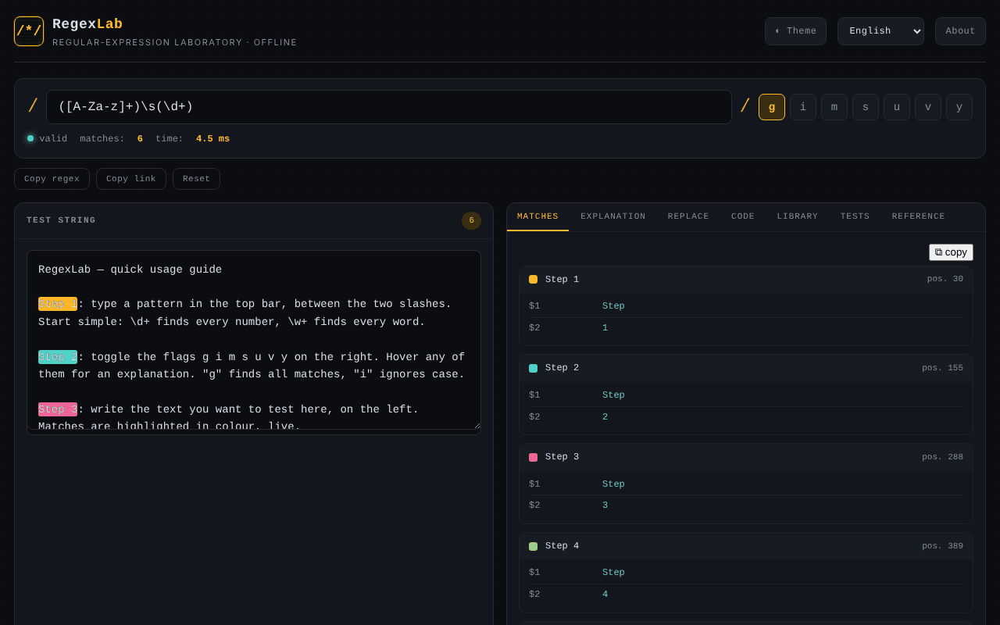

# RegexLab

**English** · [Română](README.ro.md) · [Français](README.fr.md) · [Italiano](README.it.md) · [Español](README.es.md) · [Português](README.pt.md) · [Deutsch](README.de.md) · [Magyar](README.hu.md)

**Version:** 1.2.5 · **Last updated:** 2026-10-22

Interface languages: **Română, English, Français, Italiano, Español, Português (PT), Deutsch, Magyar**

A regular-expression laboratory: live testing, explanations, replacement, code snippets and a pattern library, in a single HTML file.

**Live app:** https://chiuta.github.io/RegexLab/

## What it is

RegexLab is a tool for writing and testing JavaScript regular expressions right in the browser. The test text never leaves your device. The interface has eight languages (English, Romanian, French, Italian, Spanish, Portuguese, German, Hungarian); the default language is English.

## Features

- Pattern field (`/.../`), flags `g i m s u v y` (`u` and `v` are mutually exclusive), validity indicator ("valid" / error), match count and execution time.
- **Test string** area with match highlighting.
- **Tests** tab: test cases, one per line — `+ text` must match, `- text` must not; shows pass/fail per case and the total (evaluated in the same Web Worker, with the same time limit).
- Static (heuristic) warning for nested quantifiers, before a timeout is reached.
- The code snippets adapt named groups for Python/Go (`(?P<n>…)`) and add notes when the syntax is not available (Go: no lookaround/backreferences; Python: no `\p{…}`; PHP: `\p{…}` requires the `u` modifier).
- Seven tabs: **Matches** (matches and groups), **Explanation** (explanation of the pattern), **Replace** (replacement with `$1`, `$2`, `$&`), **Code** (ready-to-paste snippets for JavaScript, Python, PHP and Go), **Library** (15 ready-made patterns, in eight languages), **Tests** (test cases) and **Reference** (reference sheet).
- Evaluation runs in a Web Worker, with a 1500 ms time limit and a warning message for possible "catastrophic backtracking".
- **Copy regex**, **Copy link** (permalink with the pattern, flags, text and replacement in the URL's `#` fragment) and **Reset** buttons.
- Light / dark theme (**Theme**), **About** window.

## User guide

1. Open the page and choose the language from the language drop-down in the header.
2. Type the pattern in the top field and tick the flags you want.
3. Paste or type the text in **Test string**; the results appear immediately in the **Matches** tab.
4. Open **Explanation** for a breakdown of the pattern.
5. In **Replace**, type the replacement template (`$1`, `$2`, `$&`) and read the result.
6. In **Code**, copy the snippet for the language you want with the ⧉ button.
7. In **Library**, click a pattern to load it; in **Reference** you will find the basic syntax.
8. **Copy link** creates a link with the current state; **Reset** returns to the default example; **Esc** closes the About window.

## Privacy and network

- **Local storage (localStorage):** seven `regexlab-*` keys: `regexlab-pattern`, `regexlab-flags`, `regexlab-subject`, `regexlab-replace`, `regexlab-tests`, `regexlab-lang`, `regexlab-theme`. They stay only in your browser.
- **Network:** the code contains no network requests, external scripts or fonts. The About window contains links (Buy Me a Coffee, website, contact) that open only on click. No analytics or telemetry.
- The link created with **Copy link** includes the pattern and the test text in the URL; do not share it if the text is sensitive.

## Running locally / offline

Download `index.html` and open it in a browser; it works without internet.

## History / Changelog

### 1.2.5 — 2026-10-22
- Length limits for the pattern (10,000 characters), the test text (200,000), the replacement and the test cases, with a translated message: pasting 1 MB no longer freezes the page (matching itself already ran in a Web Worker with a timeout).

### 1.2.4 — 2026-10-22
- fff-kit 1.1.2: PBKDF2 600,000 iterations, anti-clickjacking protection

### 1.2.3 — 2026-10-22
- Mobile: small text raised to at least 12 px; the "copy matches" button and the footer link have larger tap targets (the ReDoS timeout in a Web Worker was already in place).

### 1.2.2 — 2026-10-22
- Field and button labels for screen readers (regular expression, test string, replacement, tests, close, language, theme) are now translated and update when the language changes.

### 1.2.1 — 2026-10-22
- Translation fixes: the page title and meta tags now follow the interface language; leftover texts in the wrong language removed.

### 1.1.0 — 2026-10-14
- Backup copy and data labelling (fff-kit).

### 12 October 2026 — version 1.0.0
- 1.0.0 — 2026-10-12: the version and the date of the last update are shown in the app

### 11 October 2026 (third pass)
- The `v` flag (unicodeSets: set operations, e.g. `[\p{L}--[a-z]]`); `u` and `v` are mutually exclusive, and the Python/PHP snippets treat it as `u`. CSP: hash recalculated.

### 11 October 2026 (second pass)
- **Tests** tab with `+`/`-` cases; heuristic warning for nested quantifiers; Python/Go/PHP snippets fixed for named groups and with compatibility notes; new texts in all 7 languages. CSP: hash recalculated.

### 11 October 2026
- Accessibility: the main content is wrapped in `<main>` (header and footer remain separate landmarks); axe-core reports 0 violations at 1280 and 360 px.
- CSP: `script-src` uses a SHA-256 hash instead of `'unsafe-inline'` (the `blob:` worker is still allowed); verified with CSP active: matching and the worker work.

## Licence

MIT — see the LICENSE file.

## Audit

Audit: 2026-10-10 — the README's claims (no network requests, storage only in localStorage) match the code; no `fetch`/CDN/WebSocket. Contrast and ARIA fixes.

## Author

Alexio — Alexandru-Ionuț Chiuță. Contact: alexio@trom.tf

## Summary

RegexLab is a single-file regular-expression laboratory: live matching with highlighting, explanation, replace, code snippets (JavaScript, Python, PHP, Go), a 15-pattern library and a reference sheet, in 8 UI languages. Matching runs in a Web Worker with a 1.5 s timeout. State is kept in localStorage; no network requests or telemetry. MIT licence.
