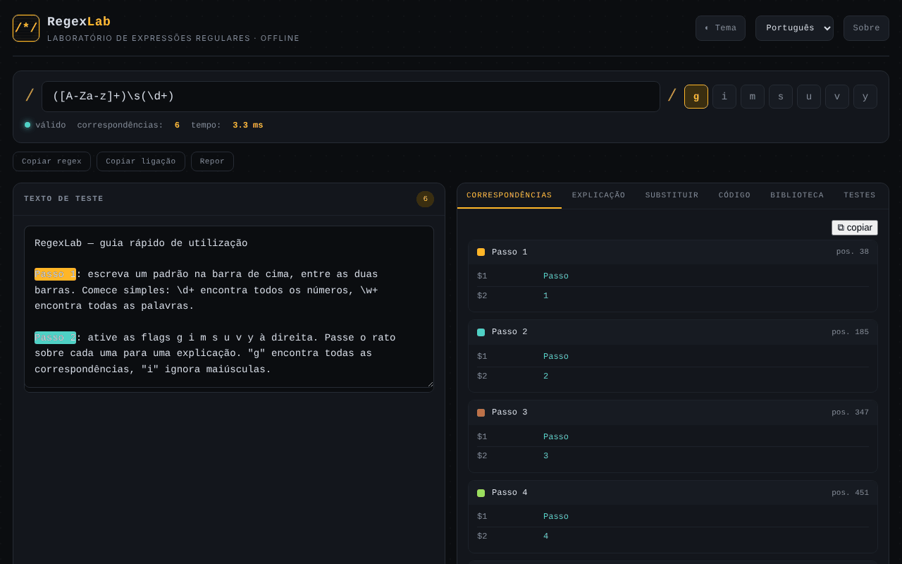

# RegexLab

[English](README.md) · [Română](README.ro.md) · [Français](README.fr.md) · [Italiano](README.it.md) · [Español](README.es.md) · **Português** · [Deutsch](README.de.md) · [Magyar](README.hu.md)

**Versão:** 1.2.5 · **Última atualização:** 2026-10-22

Idiomas da interface: **Română, English, Français, Italiano, Español, Português (PT), Deutsch, Magyar**

Laboratório de expressões regulares: teste em tempo real, explicações, substituição, excertos de código e biblioteca de padrões, num único ficheiro HTML.

**Aplicação online:** https://chiuta.github.io/RegexLab/

## O que é

O RegexLab é uma ferramenta para escrever e testar expressões regulares JavaScript diretamente no navegador. O texto de teste não sai do dispositivo. A interface tem oito idiomas (inglês, romeno, francês, italiano, espanhol, português, alemão, húngaro); o idioma predefinido é o inglês.

## Funcionalidades

- Campo do padrão (`/.../`), sinalizadores `g i m s u v y` (`u` e `v` são mutuamente exclusivos), indicador de validade ("valid" / erro), número de correspondências e tempo de execução.
- Área **Test string** com realce das correspondências.
- Separador **Tests**: casos de teste, um por linha — `+ texto` tem de corresponder, `- texto` não; mostra sucesso/falha por caso e o total (avaliados no mesmo Web Worker, com o mesmo limite de tempo).
- Aviso estático (heurístico) para quantificadores aninhados, antes de se atingir o tempo limite.
- Os excertos de código adaptam os grupos nomeados para Python/Go (`(?P<n>…)`) e acrescentam notas quando a sintaxe não está disponível (Go: sem lookaround/referências inversas; Python: sem `\p{…}`; PHP: `\p{…}` exige o modificador `u`).
- Sete separadores: **Matches** (correspondências e grupos), **Explanation** (explicação do padrão), **Replace** (substituição com `$1`, `$2`, `$&`), **Code** (excertos prontos a colar para JavaScript, Python, PHP e Go), **Library** (15 padrões já prontos, em oito idiomas), **Tests** (casos de teste) e **Reference** (folha de referência).
- A avaliação corre num Web Worker, com um limite de tempo de 1500 ms e uma mensagem de aviso para possível "catastrophic backtracking".
- Botões **Copy regex**, **Copy link** (ligação permanente com o padrão, os sinalizadores, o texto e a substituição no fragmento `#` do URL) e **Reset**.
- Tema claro / escuro (**Theme**), janela **About**.

## Manual de utilização

1. Abra a página e escolha o idioma na lista pendente de idiomas do cabeçalho.
2. Escreva o padrão no campo superior e assinale os sinalizadores pretendidos.
3. Cole ou escreva o texto em **Test string**; os resultados aparecem imediatamente no separador **Matches**.
4. Abra **Explanation** para uma decomposição do padrão.
5. Em **Replace**, escreva o modelo de substituição (`$1`, `$2`, `$&`) e leia o resultado.
6. Em **Code**, copie o excerto para a linguagem pretendida com o botão ⧉.
7. Em **Library**, clique num padrão para o carregar; em **Reference** encontra a sintaxe básica.
8. **Copy link** cria uma ligação com o estado atual; **Reset** volta ao exemplo predefinido; **Esc** fecha a janela About.

## Privacidade e rede

- **Armazenamento local (localStorage):** sete chaves `regexlab-*`: `regexlab-pattern`, `regexlab-flags`, `regexlab-subject`, `regexlab-replace`, `regexlab-tests`, `regexlab-lang`, `regexlab-theme`. Ficam apenas no seu navegador.
- **Rede:** no código não existem pedidos de rede, scripts nem tipos de letra externos. A janela About contém ligações (Buy Me a Coffee, sítio web, contacto) que só se abrem ao clicar. Sem análise estatística nem telemetria.
- A ligação criada com **Copy link** inclui no URL o padrão e o texto de teste; não a partilhe se o texto for sensível.

## Execução local / offline

Descarregue `index.html` e abra-o num navegador; funciona sem internet.

## Histórico / Registo de alterações

### 1.2.5 — 2026-10-22
- Limites de comprimento para o padrão (10 000 caracteres), o texto de teste (200 000), a substituição e os casos de teste, com mensagem traduzida: colar 1 MB já não bloqueia a página (a correspondência já corria num Web Worker com tempo limite).

### 1.2.4 — 2026-10-22
- fff-kit 1.1.2: PBKDF2 com 600.000 iterações, proteção anti-clickjacking

### 1.2.3 — 2026-10-22
- Telemóvel: o texto pequeno passa a um mínimo de 12 px; o botão «copiar correspondências» e a ligação do rodapé têm áreas de toque maiores (o limite de tempo ReDoS num Web Worker já existia).

### 1.2.2 — 2026-10-22
- As etiquetas de campos e botões para leitores de ecrã (expressão regular, texto de teste, substituição, testes, fechar, idioma, tema) estão agora traduzidas e atualizam-se ao mudar de idioma.

### 1.2.1 — 2026-10-22
- Correções de tradução: o título da página e as metaetiquetas seguem o idioma da interface; removidos os textos que ficavam no idioma errado.

### 1.1.0 — 2026-10-14
- Cópia de segurança e etiquetagem de dados (fff-kit).

### 12 de outubro de 2026 — versão 1.0.0
- 1.0.0 — 2026-10-12: a versão e a data da última atualização são apresentadas na aplicação

### 11 de outubro de 2026 (terceira passagem)
- O sinalizador `v` (unicodeSets: operações sobre conjuntos, p. ex. `[\p{L}--[a-z]]`); `u` e `v` são mutuamente exclusivos, e os excertos Python/PHP tratam-no como `u`. CSP: hash recalculado.

### 11 de outubro de 2026 (segunda passagem)
- Separador **Tests** com casos `+`/`-`; aviso heurístico para quantificadores aninhados; excertos Python/Go/PHP corrigidos para grupos nomeados e com notas de compatibilidade; textos novos nos 7 idiomas. CSP: hash recalculado.

### 11 de outubro de 2026
- Acessibilidade: o conteúdo principal está envolvido em `<main>` (o cabeçalho e o rodapé continuam a ser pontos de referência separados); o axe-core regista 0 violações a 1280 e 360 px.
- CSP: `script-src` usa um hash SHA-256 em vez de `'unsafe-inline'` (o worker `blob:` continua permitido); verificado com a CSP ativa: as correspondências e o worker funcionam.

## Licença

MIT — consulte o ficheiro LICENSE.

## Auditoria

Auditoria: 2026-10-10 — as afirmações do README (sem pedidos de rede, armazenamento apenas em localStorage) correspondem ao código; sem `fetch`/CDN/WebSocket. Correções de contraste e ARIA.

## Autor

Alexio — Alexandru-Ionuț Chiuță. Contacto: alexio@trom.tf

## Resumo

O RegexLab é um laboratório de expressões regulares num único ficheiro: correspondência em direto com realce, explicação, substituição, excertos de código (JavaScript, Python, PHP, Go), uma biblioteca de 15 padrões e uma folha de referência, com interface em 8 idiomas. A correspondência corre num Web Worker com um tempo limite de 1,5 s. O estado é guardado em localStorage; sem pedidos de rede nem telemetria. Licença MIT.
