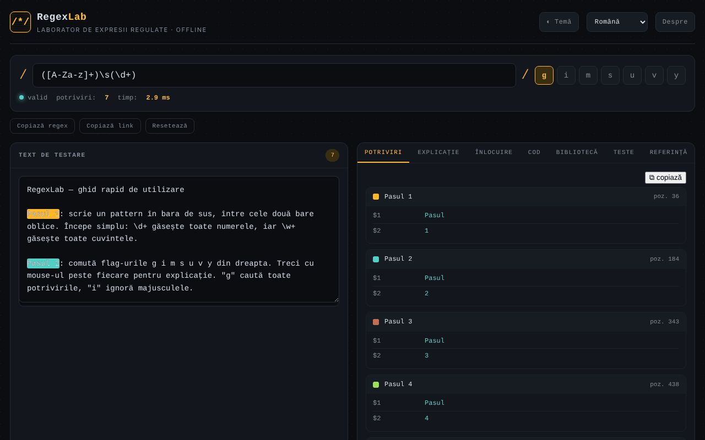

# RegexLab

[English](README.md) · **Română** · [Français](README.fr.md) · [Italiano](README.it.md) · [Español](README.es.md) · [Português](README.pt.md) · [Deutsch](README.de.md) · [Magyar](README.hu.md)

**Versiune:** 2.2.0 · **Ultima actualizare:** 2026-10-27

**Stare:** stabil · **Offline:** complet (fără cereri de rețea)

Limbile interfeței: **Română, English, Français, Italiano, Español, Português (PT), Deutsch, Magyar**

Laborator de expresii regulate: testare în timp real, explicații, înlocuire, fragmente de cod și bibliotecă de modele, într-un singur fișier HTML.

**Live:** https://chiuta.github.io/RegexLab/

## Ce este

RegexLab este un instrument pentru scrierea și testarea expresiilor regulate JavaScript direct în browser. Textul de test nu părăsește dispozitivul. Interfața are opt limbi (engleză, română, franceză, italiană, spaniolă, portugheză, germană, maghiară); limba implicită este engleza.

## Funcții

- Câmp pentru model (`/.../`), fanioane `g i m s u v y` (`u` și `v` se exclud reciproc), indicator de validitate („valid” / eroare), număr de potriviri și timp de execuție.
- Zona **Test string** cu evidențierea potrivirilor.
- Fila **Tests**: cazuri de test, un caz pe linie — `+ text` trebuie să se potrivească, `- text` nu; se afișează reușit/eșuat pe caz și totalul (evaluate în același Web Worker, cu aceeași limită de timp).
- **Depanator (2.0):** fila **Debugger** rulează un motor de potrivire instrumentat și arată pas cu pas încercările, capturile și backtracking-ul (cu butoane înainte/înapoi, cursor, redare automată și „Next match”). Este un model simplificat al motorului JavaScript (flaguri `i m s`, primele 400 de caractere; fără lookbehind și `\p{…}`), folosit doar pentru explicație. Dacă motorul depășește 50 000 de pași, se oprește și semnalează un backtracking probabil catastrofic, cu sugestii de rescriere (`(a+)+` → `(a+)`, repetiții vecine îmbinate, alternative duplicate; indicii pentru suprapuneri) și numărul de pași înainte/după pe textul tău, plus o verificare de echivalență pe textele tale.
- **Din exemple în pattern (2.0):** în **Tests**, butonul „Generate a pattern…” propune un pattern din liniile `+` și îl verifică față de liniile `-`. În **Code**, un tabel de compatibilitate avertizează despre diferențele față de PCRE/PHP, Python și RE2/Go.
- Avertisment static (euristic) pentru cuantificatori imbricați, înainte de a se ajunge la timeout.
- Fragmentele de cod adaptează grupurile numite pentru Python/Go (`(?P<n>…)`) și adaugă note când sintaxa nu este disponibilă (Go: fără lookaround/backreferințe; Python: fără `\p{…}`; PHP: `\p{…}` cere modificatorul `u`).
- Șapte file: **Matches** (potriviri și grupuri), **Explanation** (explicarea modelului), **Replace** (înlocuire cu `$1`, `$2`, `$&`), **Code** (fragmente gata de lipit pentru JavaScript, Python, PHP, Go, Java, C# și Ruby), **Library** (22 de modele gata făcute, în opt limbi), **Tests** (cazuri de test) și **Reference** (fișă de referință).
- Evaluarea rulează într-un Web Worker, cu limită de timp de 1500 ms și mesaj de avertizare la posibil „catastrophic backtracking”.
- Butoane **Copy regex**, **Copy link** (permalink cu modelul, fanioanele, textul și înlocuirea în fragmentul `#` al URL-ului) și **Reset**.
- Temă luminoasă / întunecată (**Theme**), fereastră **About**.

## Manual de utilizare

1. Deschide pagina și alege limba din lista derulantă de limbi din antet.
2. Scrie modelul în câmpul de sus și bifează fanioanele dorite.
3. Lipește sau scrie textul în **Test string**; rezultatele apar imediat în fila **Matches**.
4. Deschide **Explanation** pentru o descompunere a modelului.
5. În **Replace**, scrie șablonul de înlocuire (`$1`, `$2`, `$&`) și citește rezultatul.
6. În **Code**, copiază fragmentul pentru limbajul dorit cu butonul ⧉.
7. În **Library**, apasă un model pentru a-l încărca; în **Reference** găsești sintaxa de bază.
8. **Copy link** creează un link cu starea curentă; **Reset** revine la exemplul implicit; **Esc** închide fereastra About.

## Confidențialitate și rețea

- **Stocare locală (localStorage):** șapte chei `regexlab-*`: `regexlab-pattern`, `regexlab-flags`, `regexlab-subject`, `regexlab-replace`, `regexlab-tests`, `regexlab-lang`, `regexlab-theme`. Rămân doar în browserul tău.
- **Rețea:** în cod nu există cereri de rețea, scripturi sau fonturi externe. Fereastra About conține linkuri (Buy Me a Coffee, site, contact) care se deschid doar la clic. Fără analytics sau telemetrie.
- Linkul creat cu **Copy link** include în URL modelul și textul de test; nu-l partaja dacă textul este sensibil.

## Rulare locală / offline

Descarcă `index.html` și deschide-l în browser; funcționează fără internet.

## Noutăți 2.1.0 și ce nu este implementat (2026-10-27)

- **Generare de cod**: pe lângă JavaScript, Python, PHP, Go, Java, C# și Ruby, fila Cod generează acum fragmente pentru **Java**, **C#** și **Ruby** (escape-uri și indicatori adaptați; note când sintaxa diferă). Fragmentele Java și Ruby au fost verificate prin compilare/rulare pe un exemplu cu `\d`, ghilimele și flag-uri.
- **Bibliotecă de expresii frecvente**: 7 modele noi în categoria „Dezvoltare & web” (UUID, versiune semantică SemVer — expresia oficială semver.org, adresă MAC, oră 24 h, cuvânt repetat, link Markdown, spații la început/sfârșit); biblioteca are acum 22 de modele. Fiecare a fost testat pe exemple pozitive și negative.
- **Alte dialecte (PCRE, Python, RE2/Go)**: rămân **o tabelă de compatibilitate și conversii în fragmentele de cod**, nu o execuție reală; motorul este cel din browser (JavaScript). Rularea reală a PCRE/Python/RE2 ar cere motoare compilate în WebAssembly (sute de KB–MB, ar încălca principiul „fără dependențe”): **planificat, neimplementat**.
- **Alertă ReDoS**: exista deja (avertisment euristic + depanator cu detectare de backtracking catastrofic și limită de 1,5 s).

## 2.2.0: fragment Perl și verificarea codului generat (2026-10-27)

- **Perl** adăugat în fila Cod (`while ($text =~ m'…'indicatori) { print "$&\n"; }`; delimitatori cu apostrof, ca `$` și `@` din pattern să nu fie niciodată interpolate; i/m/s mapate, note pentru `\d \w \s` pe șiruri Unicode și pentru indicatorul sticky). Textele de ajutor în 8 limbi (fr/it/es/pt/de: traducere automată).
- **Verificarea fragmentelor cu motoare reale** (`tests/codegen.test.mjs`): pentru 9 pattern-uri, codul generat în Python, PHP, Go, Java, Ruby și Perl este rulat cu interpretorul/compilatorul real instalat aici și lista potrivirilor este comparată cu motorul JavaScript al paginii (117 verificări, 52 de execuții reale, toate egale). Cazurile Go (RE2) cu lookaround/backreferință nu sunt rulate: testul verifică că fragmentul avertizează că nu se compilează. **C# nu este rulat** (fără .NET aici) și **nu s-a adăugat** un fragment Rust (crate-ul `regex` nu este disponibil aici pentru verificare).
- Aceasta verifică *codul generat*, nu motoarele din RegexLab: **PCRE/Python/RE2 tot nu sunt executate în pagină** (ar cere motoare WebAssembly; contrazice principiul „fără dependențe”) — **planificat, neimplementat**.

## Istoric / Changelog

### 2.2.0 — 2026-10-27 (anterior: 2.1.0)

Fragment Perl; test care rulează codul generat în interpretoare reale. Execuția PCRE/Python/RE2 în pagină rămâne planificată.

### 2.1.0 — 2026-10-27 (anterior: 2.0.0)

Generare de cod Java/C#/Ruby; 7 modele noi în bibliotecă; dialectele PCRE/Python/RE2 rămân tabel de compatibilitate (execuție reală planificată).

### 2.0.0 — 2026-10-26

- Depanator vizual pas cu pas cu sugestii de rescriere anti-ReDoS, generator de pattern din exemple `+`/`-` și note de compatibilitate (PCRE/PHP, Python, RE2/Go). Teste în `tests/debugger.test.mjs`.

### 1.2.9 — 2026-10-23

- Ținte tactile de cel puțin 44 px pe dispozitive tactile (`pointer:coarse`); desktopul rămâne neschimbat.

### 1.2.8 — 2026-10-23

- CSP întărit: eliminat `blob:` din `script-src` (Worker-ul din `blob:` rămâne permis prin `worker-src`).

### 1.2.6 — 2026-10-22

fff-kit 1.1.4: ținte tactile și text minim.

### 1.2.5 — 2026-10-22
- Limite de lungime pentru pattern (10 000 de caractere), textul de test (200 000), înlocuire și cazurile de test, cu mesaj tradus: lipirea a 1 MB nu mai blochează pagina (potrivirea rula deja într-un Web Worker, cu timeout).

### 1.2.4 — 2026-10-22
- fff-kit 1.1.2: PBKDF2 600 000 iterații, protecție anti-clickjacking

### 1.2.3 — 2026-10-22
- Mobil: textul mic are acum minimum 12 px; butonul „copiază potrivirile” și linkul din subsol au ținte tactile mai mari (timeoutul ReDoS într-un Web Worker exista deja).

### 1.2.2 — 2026-10-22
- Etichetele câmpurilor și butoanelor pentru cititoarele de ecran (expresie regulată, text de test, înlocuire, teste, închide, limbă, temă) sunt acum traduse și se actualizează la schimbarea limbii.

### 1.2.1 — 2026-10-22
- Corecturi de traducere: titlul paginii și meta-etichetele urmează limba interfeței; texte rămase în limba greșită eliminate.

### 1.1.0 — 2026-10-14
- Copie de rezervă și etichetare date (fff-kit).

### 12 octombrie 2026 — versiunea 1.0.0
- 1.0.0 — 2026-10-12: versiunea și data ultimei actualizări sunt afișate în aplicație

### 11 octombrie 2026 (a treia trecere)
- Fanionul `v` (unicodeSets: operații pe mulțimi, ex. `[\p{L}--[a-z]]`); `u` și `v` se exclud reciproc, iar fragmentele Python/PHP îl tratează ca `u`. CSP: hash recalculat.

### 11 octombrie 2026 (a doua trecere)
- Filă **Tests** cu cazuri `+`/`-`; avertisment euristic pentru cuantificatori imbricați; fragmente Python/Go/PHP corectate pentru grupuri numite și cu note de compatibilitate; texte noi în cele 7 limbi. CSP: hash recalculat.

### 11 octombrie 2026
- Accesibilitate: conținutul principal este încadrat în `<main>` (antet și subsol rămân repere separate); axe-core raportează 0 încălcări la 1280 și 360 px.
- CSP: `script-src` folosește hash SHA-256 în loc de `'unsafe-inline'` (workerul din `blob:` rămâne permis); verificat cu CSP activ: potrivirile și workerul funcționează.

## Licență

MIT — vezi fișierul LICENSE.

## Audit

Audit: 2026-10-10 — afirmațiile din README (fără cereri de rețea, stocare doar în localStorage) corespund codului; fără `fetch`/CDN/WebSocket. Corecturi de contrast și ARIA.

## Autor

Alexio — Alexandru-Ionuț Chiuță. Contact: alexio@trom.tf

## Rezumat

RegexLab este un laborator de expresii regulate într-un singur fișier: potrivire în direct cu evidențiere, explicație, înlocuire, fragmente de cod (JavaScript, Python, PHP, Go, Java, C#, Ruby), o bibliotecă de 22 modele și o fișă de referință, în 8 limbi de interfață. Potrivirea rulează într-un Web Worker cu limită de 1,5 s. Starea se păstrează în localStorage; fără cereri de rețea sau telemetrie. Licență MIT.
